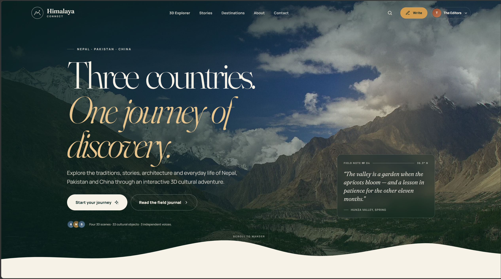
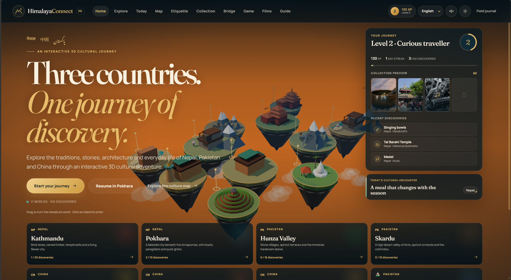
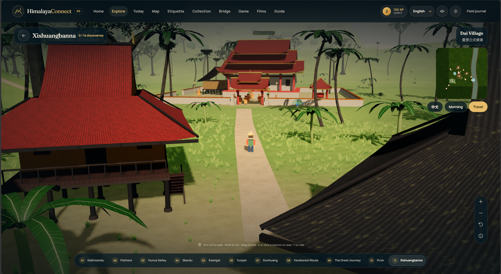
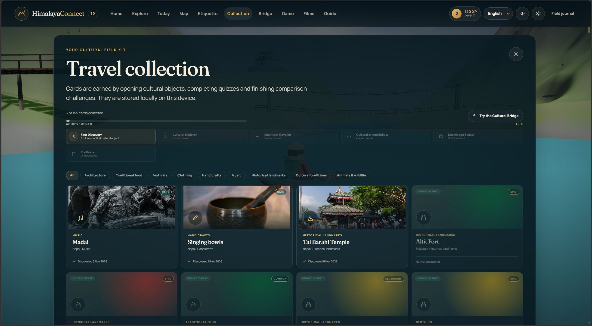
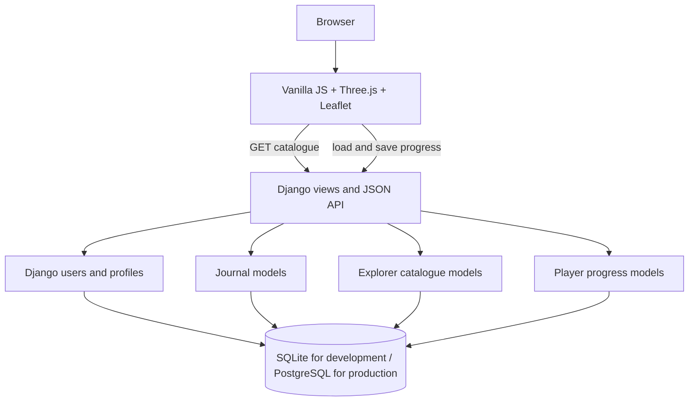

# Himalaya Connect

Himalaya Connect is a Django travel journal and interactive 3D cultural explorer. It combines editorial travel stories with playable worlds inspired by Nepal, Pakistan and China.

## Screenshots

<div align="center">
<table>
  <tr>
    <td></td>
    <td></td>
  </tr>
  <tr>
    <td></td>
    <td></td>
  </tr>
</table>
</div>

## What the project includes

### Travel journal

- Destination guides and long-form stories
- Categories, tags, search, filters and pagination
- User profiles, follows, comments, likes and bookmarks
- Story drafts, publishing and editorial administration
- Email/password, phone and optional social sign-in flows

### 3D cultural explorer

- Eleven procedural, walkable 3D worlds
- Cultural discovery items with stories, facts and quizzes
- Collectible cards, XP, achievements and daily encounters
- Scavenger hunts and comparison activities
- Cultural guide with offline curated answers and optional server-side AI proxy
- Leaflet culture map with links into the 3D worlds
- English, Simplified Chinese, Nepali and Urdu interfaces
- WebGL fallback and mobile-friendly controls

## Architecture



The application uses one database and one authentication system. The explorer is a separate Django domain inside the same project, not a second user database.

## Database design

Editorial and explorer data are separated logically within the same database:

```text
User
├── Profile
├── Posts, comments, likes and bookmarks
└── Player progress
    ├── Player discoveries
    ├── Player quiz results
    └── Player achievements

Destination
└── ExplorerWorld
    └── DiscoveryItem
        └── ExplorerQuiz

ExplorerHunt ── many-to-many ── DiscoveryItem
ExplorerAchievement
```

Important explorer models:

| Model | Purpose |
| --- | --- |
| `ExplorerWorld` | A 3D environment, optionally linked to a journal `Destination` |
| `DiscoveryItem` | A cultural object that appears in exactly one world |
| `ExplorerQuiz` | A quiz associated with a discovery item |
| `ExplorerHunt` | A collection of target discovery items and a reward |
| `ExplorerAchievement` | An unlockable player milestone |
| `PlayerDiscovery` | A user’s discovered item; unique per user and item |
| `PlayerQuizResult` | Attempts, score and pass state for a user and quiz |
| `PlayerAchievement` | A user’s unlocked achievement |
| `ExplorerProgress` | Compatibility save record for local/offline explorer state |

The normalized catalogue is stored in the database. The browser still has a bundled fallback catalogue so the explorer can remain usable if the API is temporarily unavailable.

## Project structure

```text
config/                         Django settings, URLs, ASGI and WSGI
journal/
  models.py                     Journal and explorer database models
  views.py                      Pages, authentication and explorer APIs
  urls.py                       Web and API routes
  admin.py                      Django Admin configuration
  migrations/                   Database schema history
  management/commands/
    seed_content.py             Seed editorial content and starter users
    import_explorer_content.py  Import the explorer catalogue into the DB
templates/                      Django HTML templates
static/
  css/                          Site and explorer styles
  js/explore/                   Explorer UI, data fallback and game logic
  vendor/                       Local Three.js and Leaflet builds
  images/                       Photography and cultural object images
tests/                          Browser-level explorer checks
db.sqlite3                      Local development database; ignored by Git
```

## Requirements

- Python 3.12 or newer
- Node.js, required by the explorer content importer
- A modern browser with WebGL support for the full 3D experience

## Local setup

From the project directory:

```powershell
python -m venv .venv
.venv\Scripts\Activate.ps1
pip install -r requirements.txt

python manage.py migrate
python manage.py seed_content
python manage.py import_explorer_content
python manage.py runserver
```

Open <http://127.0.0.1:8000/>.

The explorer is available at <http://127.0.0.1:8000/explore/> and Django Admin at <http://127.0.0.1:8000/admin/>.

The content importer is safe to run again:

```powershell
python manage.py import_explorer_content
```

It updates existing catalogue records instead of creating duplicates.

## Main API routes

| Route | Access | Purpose |
| --- | --- | --- |
| `/api/explorer/catalogue/` | Public | Loads worlds, discoveries, quizzes, hunts and achievements |
| `/api/explorer/progress/` | Signed in | Loads the current user’s explorer save |
| `/api/explorer/progress/save/` | Signed in | Saves the current user’s explorer save |
| `/culture-guide/` | POST | Curated or optional live cultural-guide response |

Guests can play using browser `localStorage`. Signed-in users additionally receive a database-backed save linked to their existing Django account.

## Configuration

Copy `.env.example` to `.env` and configure values appropriate for the environment:

- `DJANGO_SECRET_KEY`
- `DJANGO_DEBUG`
- `DJANGO_ALLOWED_HOSTS`
- `DJANGO_CSRF_TRUSTED_ORIGINS`
- Email settings for password resets and contact messages
- Optional `OPENAI_API_KEY`, `OPENAI_MODEL` and `OPENAI_BASE_URL`
- Optional Google, WeChat, Facebook and phone-login credentials

Never commit `.env`, passwords or API keys.

## Tests and validation

```powershell
python manage.py check
python manage.py test
python manage.py makemigrations --check --dry-run
```

The current test suite covers public pages, authentication, stories, profiles, interactions, explorer rendering, guide behaviour and security-sensitive account flows.

## Deployment notes


Before deployment:

```powershell
python manage.py migrate
python manage.py collectstatic --noinput
python manage.py import_explorer_content
```

Also configure persistent media storage, HTTPS, real email delivery, secure secrets, database backups and production rate limiting.

Because `db.sqlite3` is listed in `.gitignore`, database contents are recreated with migrations, editorial seeding and explorer-content import rather than pushed through Git.

## Credits and licensing

The project vendors Three.js and Leaflet under their respective licences in `static/vendor/`. Photography, videos, fonts and cultural sources are credited in the application and in the relevant content records. OpenStreetMap attribution is shown on the culture map.

The 3D scenes are stylised educational interpretations. They are not survey reconstructions or substitutes for current local travel guidance.
