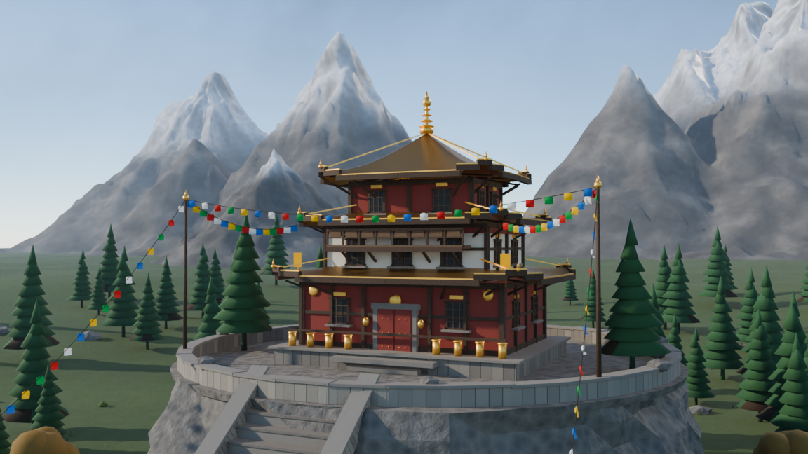
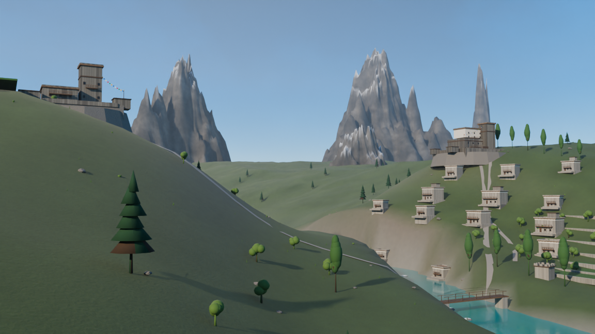

# Himalaya Connect — Blender Environment Generators

Two complete, standalone Blender Python scripts that procedurally build the
two hero environments for Himalaya Connect and render them with Cycles.

| Script | Scene |
| --- | --- |
| `himalaya_monastery.py` | Three-storey Nepalese Buddhist monastery on a rock outcrop, snow-capped Himalayan peaks, stone stairs, prayer flags, pine forest and cinematic lighting. |
| `hunza_valley.py` | Hunza Valley with Karakoram peaks (Rakaposhi, Ultar Sar, Lady Finger), a turquoise river, Baltit and Altit forts, a stone village, terraced fields, orchards and poplar groves. |

Quick previews (rendered at 60% resolution and 64 samples):





Everything is generated from code. No external textures, HDRIs, models or
add-ons are required.

---

## Requirements

- Blender **4.2 or newer** (the scripts were executed and tested against
  **Blender 5.2.3 LTS**; the sky setup also supports the Blender 4.x Nishita
  sky, and the classic compositor bloom is added automatically on 4.x).
- A GPU is optional. Cycles falls back to CPU automatically.

## Run

Run from this folder. On Windows PowerShell:

```powershell
$blender = "C:\Program Files\Blender Foundation\Blender 5.2\blender.exe"

# full-quality monastery render (1920x1080, 256 samples)
& $blender -b -P .\himalaya_monastery.py

# full-quality Hunza render (1920x1080, 64 samples)
& $blender -b -P .\hunza_valley.py
```

macOS / Linux:

```bash
blender -b -P himalaya_monastery.py
blender -b -P hunza_valley.py
```

You can also open either script in Blender's **Scripting** workspace and press
**Run Script**.

### Fast previews

```powershell
# scene + .blend only, no render
& $blender -b -P .\himalaya_monastery.py -- --no-render

# low-cost test render
& $blender -b -P .\himalaya_monastery.py -- --samples 32 --percent 40

# force CPU rendering
& $blender -b -P .\hunza_valley.py -- --samples 32 --percent 40 --cpu
```

| Flag | Meaning |
| --- | --- |
| `--samples N` | Override the Cycles sample count. |
| `--percent N` | Resolution percentage (1-100). |
| `--no-render` | Build and save the `.blend` but skip the PNG. |
| `--cpu` | Force CPU rendering. |

The scripts also respect these environment variables:

- `HIMALAYA_OUTPUT_DIR` for the monastery output folder.
- `HUNZA_OUTPUT_DIR` for the Hunza output folder.

## Outputs

By default both scripts write to:

```text
~/HimalayaConnect_Renders/
  himalaya_monastery.blend
  himalaya_monastery.png
  hunza_valley.blend
  hunza_valley.png
```

The editable `.blend` is saved **before** rendering, so it is available even
if a render is interrupted or a GPU driver fails. The `.blend` contains the
full scene, cameras, materials and render settings. The PNG is the active
camera render.

## Render configuration

Both scripts set:

- Cycles, 1920x1080, denoising (OpenImageDenoise), adaptive sampling.
- AgX view transform with a medium-contrast look where the Blender version
  exposes one.
- GPU detection: CUDA first, then OptiX, HIP, oneAPI and Metal. If no usable
  GPU is found, it renders on CPU. `--cpu` forces CPU.
- The monastery uses **256** samples (as requested); Hunza uses **64**.
- Realistic soft sun shadows, global illumination, ambient occlusion, a sky
  model and a large volumetric haze layer.

### GPU note

On some machines an OptiX kernel may fail to compile while CUDA works. The
scripts try CUDA before OptiX for that reason. If a render fails at the GPU
stage, re-run with `--cpu` or update the NVIDIA driver.

## What each script builds

### `himalaya_monastery.py`

- Procedural polar heightfield mountain massifs with ridged multifractal
  displacement, snow masks computed from altitude and slope, and a rock/snow
  shader mix.
- A rocky outcrop with a displaced cliff, retaining wall and stone stairs.
- A detailed three-storey monastery: stone plinth, red and white plaster
  storeys, dark timber posts and beams, lattice windows, carved doors,
  balconies, prayer-wheel row, three curved pagoda roofs with gold ridges,
  corner ornaments and a gilded finial.
- Five prayer-flag lines (five traditional colours), catenary ropes, wooden
  poles and gently fluttering cloth panels.
- Procedural pines, deciduous trees, shrubs, grass tufts, boulders and cairns.
- A stupa, stone lanterns, a path and a foreground staircase.
- Nishita / multiple-scattering sky, world clouds, volumetric haze, sun key,
  fill and rim lights.
- Main 35 mm cinematic camera plus wide, detail and staircase cameras.
- Collections: `Mountains`, `Monastery`, `Terrain`, `Vegetation`,
  `Prayer_Flags`, `Lighting`, `Cameras`.

### `hunza_valley.py`

- Eight Karakoram massifs with sharp ridged peaks, rock faces and snow caps,
  plus a glacier tongue and seracs.
- A carved valley heightfield with erosion gullies, scree, grass and dirt
  vertex colours.
- A winding turquoise river with a reflective water shader, riverbed, foam
  and boulders, plus a wooden bridge.
- Fourteen stone houses with timber balconies, flat roofs, roof beams, plaster
  bands and terraced yards.
- Baltit Fort: multi-tier keep, tower, crenellations, timber balconies,
  windows, courtyard walls, gate and prayer flags.
- Altit Fort: rock platform, tall crenellated tower, hall, balconies,
  outbuildings and prayer flags.
- Seven terraced fields on the east bank, four near Altit, with crop rows and
  irrigation channels.
- Pine slopes, poplar rows, apricot orchards, shrubs, grass and riverbank
  boulders.
- Volumetric haze and low river mist, Nishita sky, warm key light and cool
  fill/rim lights.
- Main 35 mm valley camera plus overview, Baltit close-up, river, mountain and
  aerial cameras.
- Collections: `Karakoram_Mountains`, `Hunza_Terrain`, `Hunza_River`,
  `Traditional_Village`, `Baltit_Fort`, `Altit_Fort`, `Vegetation`,
  `Lighting`, `Cameras`.

## Customisation

Each script has a configuration block at the top:

```python
SEED = 31415            # change for a different landscape
RES_X, RES_Y = 1920, 1080
SAMPLES = 256
RES_PERCENT = 100
PLATFORM_Z = 12.0
```

Changing `SEED` changes the procedural placements and tree/rock variations.
The mountain tables, camera positions and house/fort layout lists are plain
Python data near the corresponding `build_*` functions, so they are easy to
edit.

## Notes

- The prayer flags are generated with a deterministic procedural cloth
  deformation (sine waves and catenary sag) so renders are repeatable and do
  not require a simulation bake. If you want real cloth, select a flag object
  and add a Cloth modifier with a pinned top row.
- Blender 5.x replaced the classic scene compositor with node-group
  compositing. The scripts detect that and skip the optional bloom; the render
  and all materials/lighting are unaffected. On Blender 4.x the subtle glare
  node is added.
- The preview images in `previews/` were produced with `--samples 64
  --percent 60` to keep them lightweight; the scripts render at full quality by
  default.
